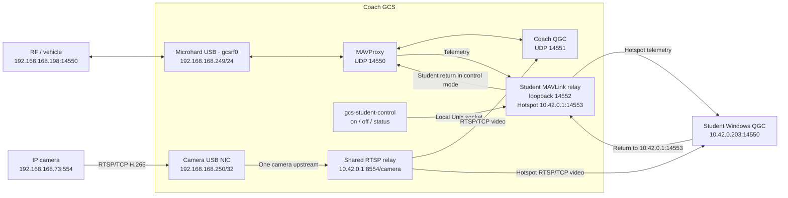

# GCS architecture

整理日期為 2026-11-13。表內使用範例位址。部署時依 SOP 核對網卡與路由。

## Data flow

## Interfaces and routes

| Role | Interface / address | Reason |
| --- | --- | --- |
| Management | 管理網卡，192.0.2.18/16 | SSH，與教學網路分開 |
| RF | Microhard USB gcsrf0，192.168.168.249/24 | 對端 .198 的 /32 路由指定此介面 |
| Camera | enx001122334455，192.168.168.250/32 | 對端 .73 的 /32 路由指定此介面 |
| Hotspot | wlp2s0，10.42.0.1/24 | SSID=GCS_Hotspot，供學員連線 |
| 舊 PCI RF | enp0s31f6，unmanaged | 已關閉舊 RF profile 自動連線 |
| Other hardware | 第二張 Wi-Fi | 獨立於 RF、攝影機與學員 Hotspot |

Microhard 電台本身的位址為 .199，GCS 端的 USB 網路介面使用 .249。NetworkManager 在開機時啟用 gcs-rf-usb profile。RF 對端 .198 仍將封包送到 .249:14550。

RF .198 與攝影機 .73 的兩條主機路由分別走 Microhard USB 與攝影機 USB。管理 SSH 走獨立的網卡。

## Ports

| Endpoint | Protocol | Purpose |
| --- | --- | --- |
| GCS 192.168.168.249:14550 | UDP | MAVProxy 接收 RF，回程也經此 RF 鏈路 |
| GCS 127.0.0.1:14551 | UDP | 教練 QGC 接收遙測 |
| GCS 127.0.0.1:14552 | UDP | 學員 relay 接收 MAVProxy 遙測 |
| GCS 10.42.0.1:14553 | UDP | relay 對學員的來源埠與學員回程接收埠 |
| Windows 10.42.0.203:14550 | UDP | 學員 QGC 接收埠 |
| Camera 192.168.168.73:554 | RTSP/TCP | 影像 relay 唯一的攝影機上游 |
| GCS 10.42.0.1:8554/camera | RTSP/TCP | 教練與學員共用的影像來源 |

MAVProxy 輸出 socket 的來源埠由系統分配，重新啟動可能改變。教練 QGC 與學員 relay 依收到資料的來源端點回覆；學員 QGC 回覆 GCS 10.42.0.1:14553。不是把遙測與控制分成兩個獨立的單向埠後各自開關。

## Student control mechanism

student-relay.py 使用單一 Python 事件迴圈與 selectors 處理 MAVProxy UDP、學員 UDP 及本機控制 socket。

- control：遙測送學員，學員回程轉給 MAVProxy，由 MAVProxy 送往飛控。
- monitor：遙測照送，學員回程在程式內丟棄並累計 student_dropped。
- on：排掉舊的接收佇列後恢復新封包轉送。
- off：只切換 relay 狀態，不修改 nftables／iptables。

教練 CLI 必須以 root 執行，透過 Unix datagram socket 發出請求；relay 驗證 Linux 程序憑證。學生 IP 與來源埠由 UDP socket 的對端綁定限制。

這只管經過 relay 的 MAVLink 回程。其他可直接到 RF 的網路路徑、飛控 RC／failsafe 與已執行的任務不是這個開關控制的範圍。

## Video mechanism

video-relay.py 使用 GStreamer RTSP Server，共用一個 media factory，將攝影機 H.265 RTP 解封裝、解析後重新封裝成 RTP，提供 RTSP/TCP 播放。沒有轉碼，不會把 H.265 改成 H.264。

攝影機登入網址存放在 /etc/gcs/video-relay.json 的 upstream_url，權限 0640。教練 QGC 已切換成 relay URL 後，服務仍讀取獨立的相機上游，不會把自己當成攝影機。

影像用戶端共用一條實體相機連線。現場多路直連曾測到影像只播第一批就停住，改為單一上游後持續播放驗證通過。這是現場改善結果，不宣稱已由相機廠商證實裝置的連線數上限。

影像服務與 MAVLink relay 分開，因此 student-control off 仍可保留影像。它綁定 Hotspot 位址、不額外驗證影像用戶端帳號；可連通該埠的 Hotspot 用戶端可收看。

## Services and files

| Path / unit | Purpose |
| --- | --- |
| config.json（部署包根目錄） | install 安裝／更新的統一設定入口；含 RF、Hotspot、學員與 video 設定 |
| gcs-hotspot.service | 啟用 NetworkManager Hotspot，oneshot active/exited |
| gcs-mavproxy.service | 執行 MAVProxy RF 分流 |
| gcs-student-relay.service | 學員 MAVLink 程式控制 |
| gcs-video-relay.service | RTSP 影像轉送 |
| /etc/gcs/gcs-mavproxy.env | RF master、教練與 relay 輸出 |
| /etc/gcs/student-relay.json | Hotspot／學員 IP、boot_default |
| /etc/gcs/rf-bundle.json | 安裝來源、受管理 Hotspot UUID、安裝狀態 |
| /etc/gcs/video-relay.json | 私有攝影機上游、影像監聽位址與 codec |
| /opt/gcs/run-mavproxy.sh | MAVProxy 執行入口 |
| /opt/gcs/student-relay.py | 學員 UDP relay |
| /opt/gcs/video-relay.py | 影像 relay |
| /opt/gcs/venv | MAVProxy Python 執行環境 |
| /usr/local/sbin/gcs-student-control | 教練 CLI |
| /run/gcs-student-relay/ | 控制 socket 與短期模式狀態 |
| /var/lib/gcs/mavproxy/ | 遙測日誌 |
| ~/.config/QGroundControl/QGroundControl.ini | 該使用者的 QGC 設定 |
| /etc/systemd/network/10-gcs-rf-usb.link | 以 Microhard USB 裝置 ID 固定介面名稱 gcsrf0 |
| /etc/NetworkManager/conf.d/90-gcs-ignore-rf-pci.conf | 現場專用，將舊 PCI RF 設為 unmanaged |

RuntimeDirectoryPreserve=restart 讓學員 relay 的程序 restart 保留模式；明確停止後開始及整機重開套用 boot_default。影像服務等待 Hotspot 位址就緒後才綁定監聽埠。現場教練 QGC 透過獨立的桌面登入自啟設定啟動。

## Firewall

平常 on/off/start/stop 使用程式與服務控制。NetworkManager 的 shared Hotspot 仍管理 DHCP、路由及 NAT。

## Package boundaries

根目錄腳本管理整套。mavlink/ 只管理 MAVLink／Hotspot，video/ 只管理影像。網卡靜態 profile 與 QGC 程式由 SOP 前置步驟設定，移除服務時保留，另有手動還原說明。

修改根目錄 config.json 後重跑 01_install.sh 會更新既有設定。RF／Hotspot 的已配置 profile 會依新值更新，影像監聽 IP 由 hotspot_address 推導；上方圖表為預設位址範例。更新保留 Hotspot 密碼與教練目前控制模式。video.upstream_url 留空會沿用已保存的攝影機網址，有填值則採用新值。各元件先在 /var/backups/gcs/ 備份，失敗時嘗試回復該元件；影像失敗不會撤回已完成的 MAVLink 更新。攝影機硬體、其專用網卡／路由、Windows IP 與 QGC 使用者設定仍需同步維護。

2026-11-11 現場已完成一次 GCS 重開機驗證。Microhard USB 自動取得 .249、PCI 維持 unmanaged，四個服務均自啟，MAVProxy 偵測到飛控。教練 QGC 由桌面登入自啟，Windows 學員端由使用者確認通過。

新機首次安裝需依 SOP 驗收。 [現場與封裝驗證紀錄](verification/README.md)
