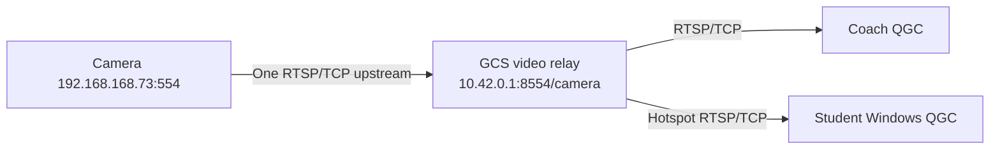

# Shared RTSP video relay

影像 relay 獨立於 MAVLink 執行，安裝後設為開機啟用。



教練與學員 QGC 均選 RTSP Video Stream，URL 使用：

```text
rtsp://10.42.0.1:8554/camera
```

此服務共用同一個 H.265 上游，不做影像轉碼。綁定 Hotspot 位址，只提供 TCP 播放；連上 Hotspot 且可連通此位址的用戶端可收看，不會依 MAVLink 的學員 IP 設定限制影像用戶端。攝影機登入資訊保存在 GCS 的 /etc/gcs/video-relay.json，root 擁有、教練帳號群組可讀，權限 0640。本部署包不含該登入設定檔。

## Install on another GCS

先完成攝影機專用網卡與路由。根目錄 [config.json](../config.json) 的 video.upstream_url 可填入攝影機的實際完整 RTSP URL；留空時沿用已保存的上游，首次安裝則從教練 QGC 讀取。預設 Hotspot 為 10.42.0.1、codec 為 h265，可在 config.json 修改。

在本 video 資料夾執行：

```bash
sudo bash ./01_install.sh --user user
```

安裝程式將攝影機 URL 獨立保存在受限權限的設定檔，部署服務並開機啟用。缺少 GStreamer RTSP Server 或指定 codec 的處理元件時會安裝所需套件，需可連到 Ubuntu 套件來源。影像監聽 IP 自動沿用 config.json 的 hotspot_address，服務埠由 video.port 決定，路徑為 /camera。

安裝完成後，將教練與學員 QGC 的 RTSP URL 都改成上方 relay 網址。避免同時使用多個程式直連實體攝影機：此次直連競爭時出現停流，共用單一上游後連續測試通過。再次安裝會保留已保存的攝影機 URL，避免把教練後來的 relay URL 當成上游而形成迴圈。

換攝影機時修改根目錄 config.json 的 video.upstream_url，並重跑整套或本目錄的 01_install.sh。上游留空保留舊值，有填值則以新值為準。更新前在 /var/backups/gcs/ 建立私有備份，服務啟動失敗時嘗試回復；相同設定與程式不會重啟服務。不要把含登入資訊的設定檔放入共用部署 ZIP。需要私有設定檔時可傳入 --config /受限路徑/config.json。

## Start, stop and remove

```bash
sudo bash ./02_start.sh
sudo bash ./03_stop.sh
sudo bash ./04_remove.sh

sudo systemctl status gcs-video-relay.service --no-pager
sudo systemctl restart gcs-video-relay.service
```

也可直接使用：

```bash
sudo systemctl start gcs-video-relay.service
sudo systemctl stop gcs-video-relay.service
sudo systemctl enable gcs-video-relay.service
sudo systemctl disable gcs-video-relay.service
```

start/stop 控制目前程序；enable/disable 控制開機啟用。移除腳本移除影像服務、其專用程式及設定，保留 GStreamer 套件與 MAVLink 服務。

本完整包根目錄的腳本管理整套，mavlink 子目錄只管理 MAVLink，video 子目錄只管理影像。一般使用根目錄的開始、停止及移除入口，以正確順序處理 Hotspot 依賴。

gcs-student-control off/on 僅控制學員 MAVLink 回程。切成只監看時，影像 relay 仍可提供影像。

## Verification

學員 Windows 10.42.0.203 的 DESCRIBE、SETUP、PLAY 均回覆 200，8 秒收到 1346 個 RTP 封包，重新連線成功。教練 QGC 同時收看時，另一個 GCS 解碼用戶端在 30 秒內解碼 448 張 1920 x 1080 影格，尾段仍約 15 fps，無警告。最終實體攝影機只保留 video relay 的一條 TCP 上游連線。未重啟整台 GCS 或以學員 QGC GUI 作為本次驗收依據。

- [驗證紀錄](../verification/README.md)
- [GStreamer shared factory reference](https://gstreamer.freedesktop.org/documentation/gst-rtsp-server/rtsp-media-factory.html)
